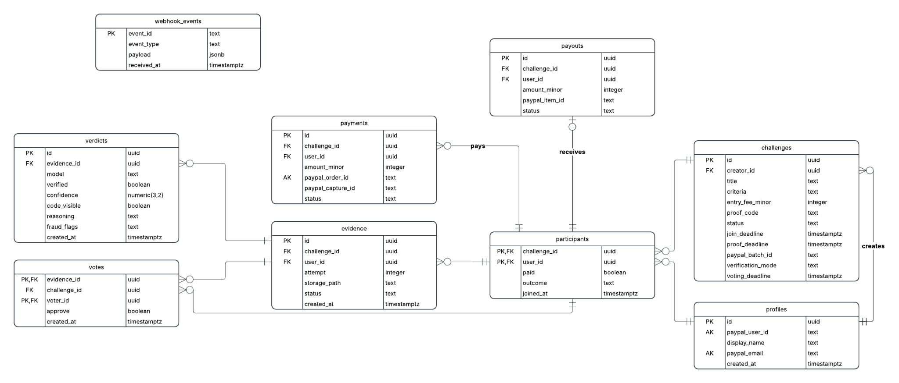

<div align="center">
  

  <h1>KeepIt</h1>

  <p>
    <strong>Make a pact with friends, put in an Entry Fee, and prove you did it.</strong><br />
    The AI Arbiter checks your photo. PayPal settles the pool.
  </p>

  <p>
    <a href="https://github.com/Paypal-Hackathon2026/KeepIt/actions/workflows/tests.yml">
      
    </a>
    
    
    
    
    
    <a href="LICENSE">
      
    </a>
  </p>

  <p>
    <a href="#demo-video">Demo Video</a> ·
    <a href="#how-it-works">How It Works</a> ·
    <a href="#tech-stack">Tech Stack</a> ·
    <a href="#getting-started">Getting Started</a> ·
    <a href="#running-tests">Running Tests</a>
  </p>
</div>

---

## About KeepIt

**KeepIt** is a social accountability web app built for **PayPal Hackathon 2026**. We built it because it is all too easy to promise *"I'll do it tomorrow"* and let it slide. KeepIt turns personal commitments into friendly group challenges backed by real stakes.

> [!NOTE]
> All authentication, payments, and payouts currently run in **PayPal Sandbox** mode (`api-m.sandbox.paypal.com`) using test accounts and sandbox balances in **PLN**. No real money is processed.

---

## Demo Video

> **Hackathon Submission Video:** **[Watch the Demo Video](https://youtu.be/yVh7GClYxMI)**

---

## URl to demo version

You can test our app on [Test our app](https://keepit-xuif.onrender.com/)

For testing you need to use Sandbox Paypal accounts - if you wish to test, reach out and we will create you as many accounts as you need for your test.
If you wish to learn how our app works, but you do not have time for testing we recommend you to check out this report:
### [How it works - report with screens](docs/how_the_app_works.md)

---

## How It Works

1. **Make a pact** — Sign in with **Log in with PayPal**, create a challenge with completion criteria, an Entry Fee (in PLN), join and proof deadlines, and either **AI Arbiter** or **Group Vote** verification mode. Invite friends via link and lock in spots by paying the Entry Fee through PayPal Checkout.
2. **Prove it** — Before the proof deadline, upload a photo that includes your challenge's unique **proof code**:
   - **AI Arbiter mode** (up to 3 attempts): **Google Gemini** inspects the photo against the challenge criteria, verifies the visible proof code, checks for fraud flags (such as `missing_code` or `screen_of_screen`), and either auto-approves (`confidence >= 0.7`), auto-rejects (`< 0.4` or missing code), or sends borderline submissions (`0.4–0.69`) to **peer voting**.
   - **Group Vote mode** (1 attempt): Participants vote directly on submitted evidence before the voting deadline.
3. **Settle up** — Once deadlines pass or all participants are resolved, KeepIt's settlement engine and background worker (`sync_settle_worker`) compute the payouts and dispatch them automatically via **PayPal Payouts**. Completers get their Entry Fee back plus an equal share of the Entry Fees forfeited by those who did not complete the challenge (if everyone forfeits or evidence remains unresolved, participants receive refunds).

### Key Features

- **PayPal OAuth Identity** (`Log in with PayPal`) with signed session cookies
- **End-to-End PayPal Financial Flow** — Orders API checkout, Capture verification, Batch Payouts, and idempotent Webhook handling (`POST /paypal/webhook`)
- **Multimodal AI Verification** — Structured JSON verdicts with confidence thresholds, fraud flags, and ordered model fallback via `GEMINI_MODELS`
- **Peer Voting Fallback & Vote Mode** — Automatic escalation for uncertain AI verdicts or community-voted challenges
- **Challenge Dashboard & Filtering** — Filter challenges by status or verification mode and sort by deadline, newest, or pool size
- **Profile & Net Result** (`/profile`) — Track challenges joined/completed, amount locked in active challenges, and cumulative Net Result in PLN
- **Live UI Updates with HTMX** — Responsive challenge state polling and partial HTML swaps without heavy JavaScript frameworks

---

## Tech Stack

| Layer | Technology | Role in KeepIt |
| :--- | :--- | :--- |
| **Payments & Identity** | **PayPal APIs (Sandbox)** | Log in with PayPal (OAuth 2.0), Orders, Batch Payouts, and Webhooks |
| **AI Arbiter** | **Google Gemini** (`google-genai`) | Multimodal vision evaluation of proof photos and proof codes |
| **Backend** | **FastAPI** + **Jinja2** | Async Python routes, session middleware, SSR templates, and background settlement loop |
| **Database & Storage** | **Supabase** | PostgreSQL database, atomic RPC (`create_challenge_with_participant`), and `evidence` photo bucket |
| **Frontend Reactivity** | **HTMX 2.0** + CSS | Polling challenge states and dynamic partial swaps without bulky JS bundles |
| **Hosting** | **Render** | Cloud deployment for the FastAPI web service |
| **API Testing** | **Postman** | Sandbox test collections for OAuth login and Orders flows (`docs/postman/`) |

---

## Getting Started

### Prerequisites

- **Python 3.12+**
- **Git**
- A **Supabase** project
- A **PayPal Developer** Sandbox app (with *Log in with PayPal*, *Orders*, *Payouts*, and a Webhook enabled)
- A **Google Gemini** API key

### 1. Clone the repository

```bash
git clone https://github.com/Paypal-Hackathon2026/KeepIt.git
cd KeepIt
```

### 2. Create a virtual environment and install dependencies

**Windows (PowerShell):**

```powershell
py -m venv .venv
.\.venv\Scripts\Activate.ps1
python -m pip install -r requirements.txt
```

**macOS / Linux:**

```bash
python3 -m venv .venv
source .venv/bin/activate
python -m pip install -r requirements.txt
```

### 3. Configure environment variables

Copy `.env.example` to `.env` and fill in your credentials:

```bash
cp .env.example .env
```

| Variable | Required | Description |
| :--- | :---: | :--- |
| `APP_URL` | Yes | Base URL of your app (e.g. `http://localhost:8000`); used for OAuth `/auth/callback` and PayPal return URLs |
| `SESSION_SECRET` | Yes | Secret string used to sign session cookies |
| `PAYPAL_CLIENT_ID` | Yes | PayPal Sandbox REST app Client ID |
| `PAYPAL_SECRET` | Yes | PayPal Sandbox REST app Secret |
| `PAYPAL_WEBHOOK_ID` | Yes | PayPal Webhook ID pointing to `<APP_URL>/paypal/webhook` |
| `SUPABASE_URL` | Yes | Your Supabase project URL |
| `SUPABASE_SECRET_KEY` | Yes | Supabase service/secret API key |
| `GEMINI_API_KEY` | For AI mode | Google Gemini API key |
| `GEMINI_MODELS` | For AI mode | Comma-separated Gemini model IDs tried in priority order on transient errors / rate limits |
| `PAYPAL_API_BASE` | No | Optional override; defaults to `https://api-m.sandbox.paypal.com` |
| `PAYPAL_WEB_BASE` | No | Optional override; defaults to `https://www.sandbox.paypal.com` |

### 4. Set up Supabase

1. Open your Supabase project's **SQL Editor** and run [`supabase/schema.sql`](supabase/schema.sql). It creates the database schema and the `create_challenge_with_participant` RPC used by the app.
2. In Supabase **Storage**, create a bucket named `evidence` for uploaded proof images.

<details>
<summary>View Database ERD</summary>
<p align="center">
  
</p>
</details>

### 5. Run the application locally

```bash
uvicorn app.main:app --reload
```

Open **`http://localhost:8000`** in your browser (`GET /health` returns service health status).

> [!TIP]
> Need help configuring PayPal Sandbox OAuth or Orders? Check the step-by-step Postman guides in [`docs/postman/`](docs/postman/).

---

## Running Tests

Install development dependencies (includes `pytest` and runtime packages) and run the suite:

**Windows (PowerShell):**

```powershell
py -m venv .venv
.\.venv\Scripts\Activate.ps1
python -m pip install -r requirements-dev.txt
python -m pytest -q
```

**macOS / Linux:**

```bash
python3 -m venv .venv
source .venv/bin/activate
python -m pip install -r requirements-dev.txt
python -m pytest -q
```

Tests use dummy service credentials defined in [`tests/conftest.py`](tests/conftest.py); database and external payment/AI operations are mocked, so the test suite runs offline without a `.env` file or live API keys.

---

## Project Structure

```text
KeepIt/
├── app/
│   ├── main.py              # FastAPI app, session middleware, background settlement loop
│   ├── config.py            # Environment configuration loader
│   ├── routes/              # Auth, pages, challenges, and PayPal routes & webhooks
│   ├── services/            # AI Arbiter, evidence upload, payouts, settlement, profiles, filters
│   ├── models/              # Pydantic models
│   ├── templates/           # Jinja2 pages & HTMX partials
│   └── static/              # CSS & SVG/PNG assets
├── supabase/
│   ├── schema.sql           # Core PostgreSQL schema + RPCs
│   └── ERD.jpg              # Database ERD
├── docs/postman/            # Postman collections & PayPal sandbox test guides
├── tests/                   # Pytest unit and integration tests
├── requirements.txt         # Runtime dependencies
├── requirements-dev.txt     # Test/dev dependencies
└── .env.example             # Environment variable template
```

---

## Team

Built by:

- **Julia Radzimska** — [@jradzimska](https://github.com/jradzimska)
- **Kamil Bartel** — [@zmoraogorow](https://github.com/zmoraogorow)
- **Alicja Jakowczuk** — [@jakowczukalicja](https://github.com/jakowczukalicja)
- **Tomasz Białecki** — [@tomciolowsky](https://github.com/tomciolowsky)

---

## License

This project is licensed under the **MIT License** — see the [`LICENSE`](LICENSE) file for details.
