## Main Idea

Our app locks your deposits through PayPal, paying out the prize pool if your submission was positively verified for this challenge.

## Home Page

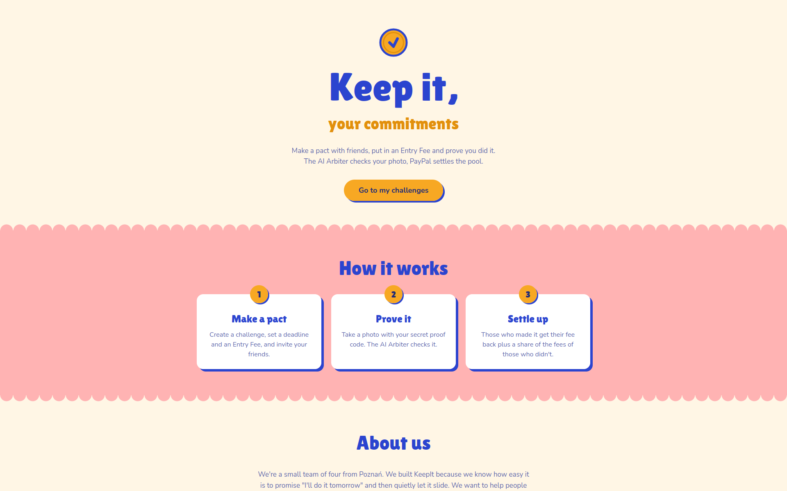

## My Challenges

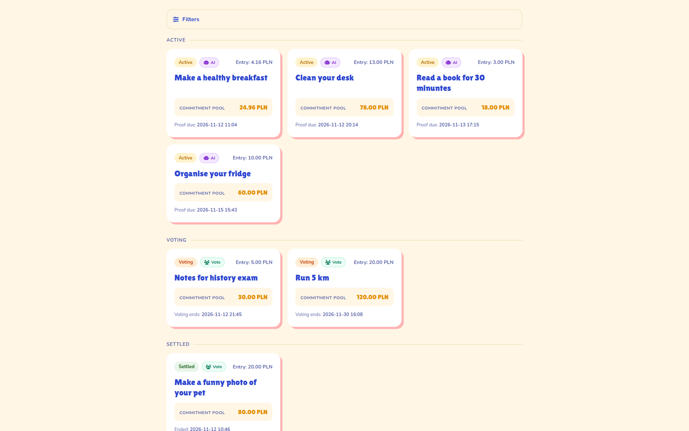

On the "My Challenges" page, you can see challenges that you joined. They are sorted by their status (open, active, voting, closed, settled).
You may also use the filters appearing at the top if you want to see only a specific type of challenges. For every challenge you also see basic info, like whether it is judged by AI or by community voting, the current commitment pool, entry fee, and the closest deadline for a challenge (join, proof, or voting).

## User Profile

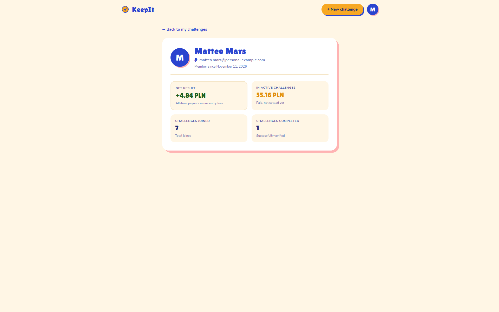

In the user profile, you can find information about how many challenges you have joined and how many positively verified submissions you have. You can also see how much money you have in active challenges and how much profit you have gained or lost—if you did not stick with the challenge goals.

## New Challenge

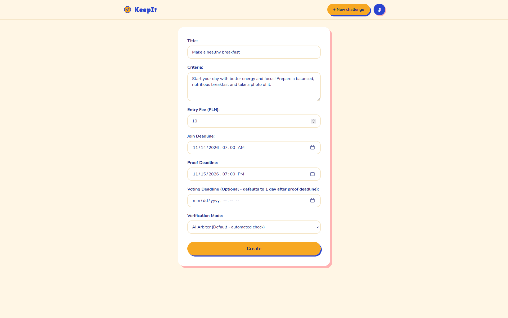

In the challenge form you specify:
- the title,
- criteria (they are crucial for our AI arbiter, so make them pretty specific),
- entry fee,
- join deadline,
- proof deadline,
- voting deadline, which defaults to 1 day after proof deadline,
- verification mode: AI arbiter or simple community voting.

## AI Arbiter

For every challenge verified by the AI arbiter, we give users 3 attempts, in case they forgot to add the proof code or uploaded the wrong picture.
Our AI Arbiter looks at your submission, compares it with the challenge criteria and the required proof code.
The Arbiter gives you a short justification of the decision—tagged with key features that the decision was based upon when the decision is negative.
Then for any submission, you can get one of three verification results:

### Verified
The AI Arbiter is sure that the criteria are met, the proof code is visible, and the challenge can be objectively judged based on a picture.

Some examples below:
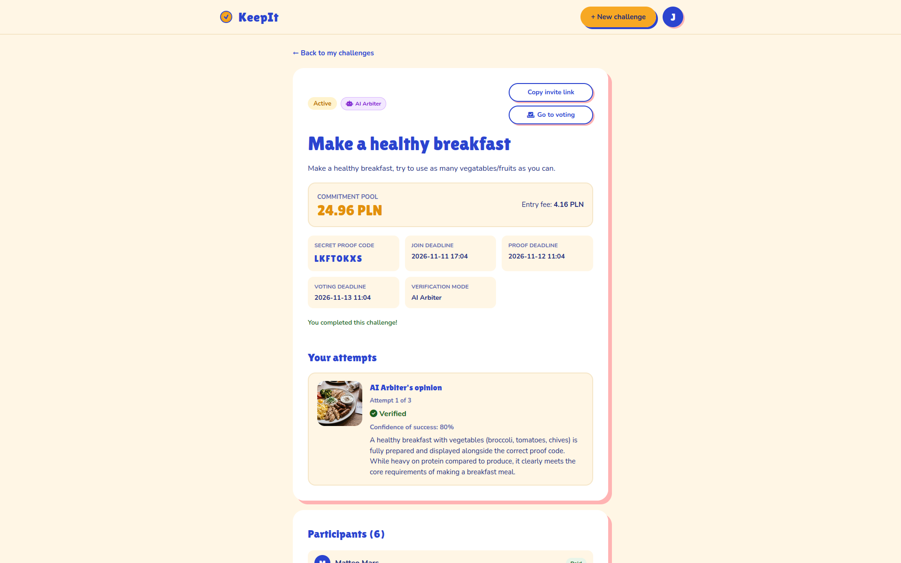
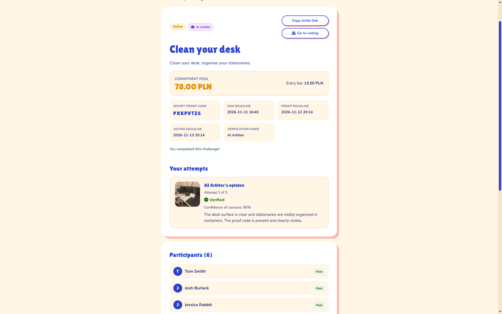
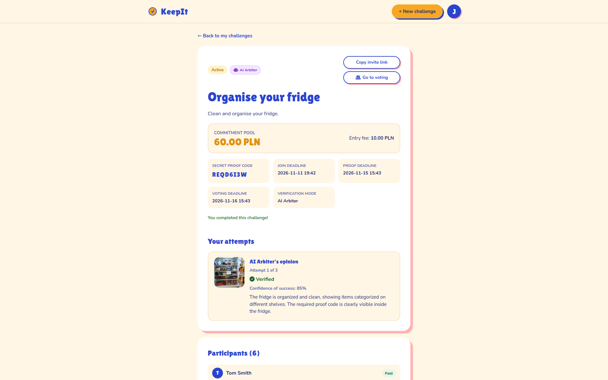

### Rejected
The AI Arbiter is sure that some element is lacking (like the proof code), some criteria are not met, or the submission is a fraud attempt (for example, a picture of an image displayed on a screen).

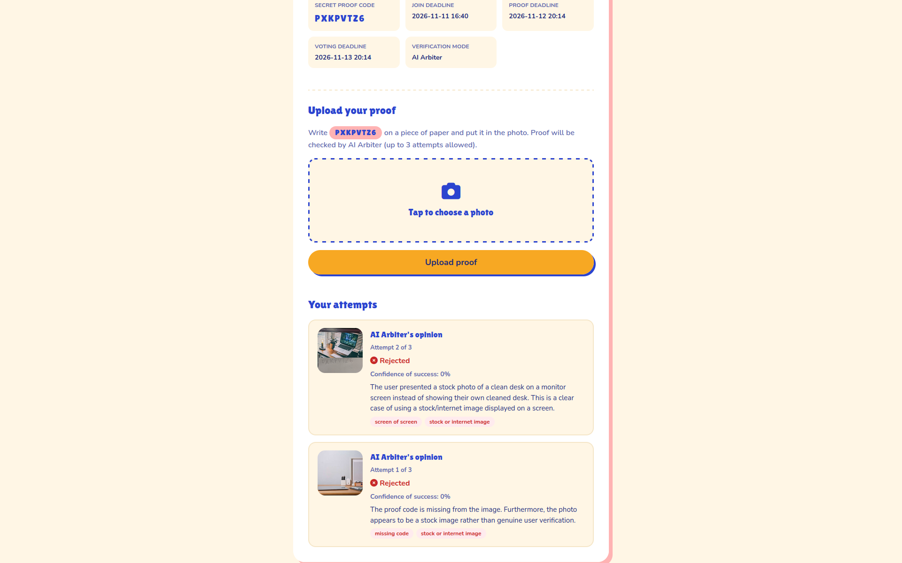

### Sent to Voting
If the AI arbiter is not sure or if it believes that such a challenge cannot be objectively judged by AI (because it involves time duration, etc.), the challenge is then sent to group voting, where other participants vote.

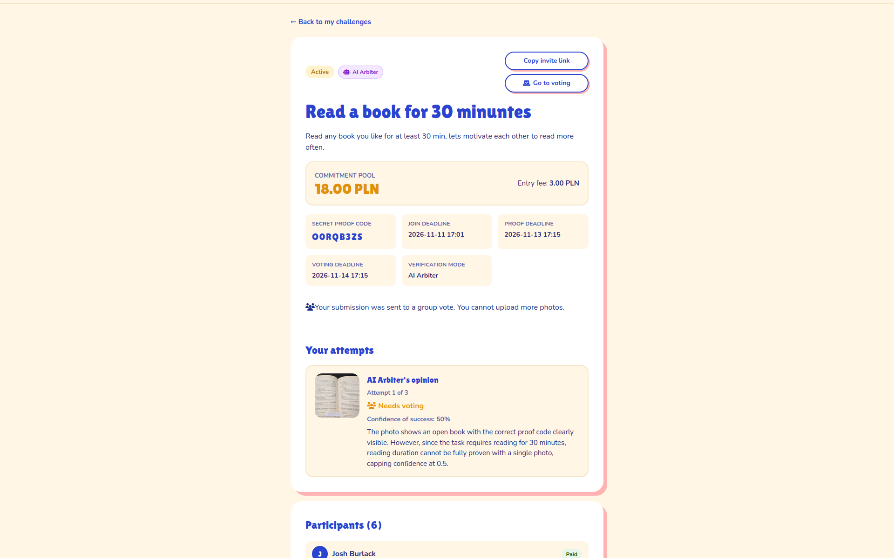

## Voting

Community voting can be chosen as the primary option for verification, but it is also used when the AI arbiter hits a gray area.
Submissions in the voting feed are sorted by submission time. Your submission is placed on the right side, whereas submissions from other users sit on the left side.
The idea was for it to look like an internet communicator. You can vote for or against a submission using the upvote and downvote buttons. For voting to work, we require at least 3 participants—if the number is less, the entry fees will be simply refunded to users. We require more than 50% of users to give an upvote for a submission to be classified as approved.

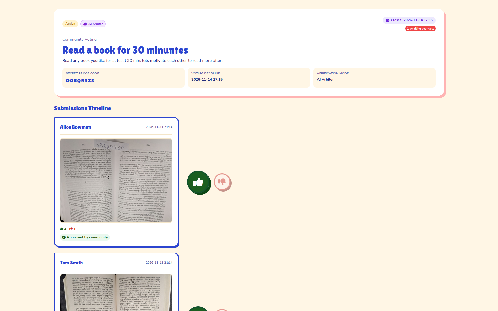
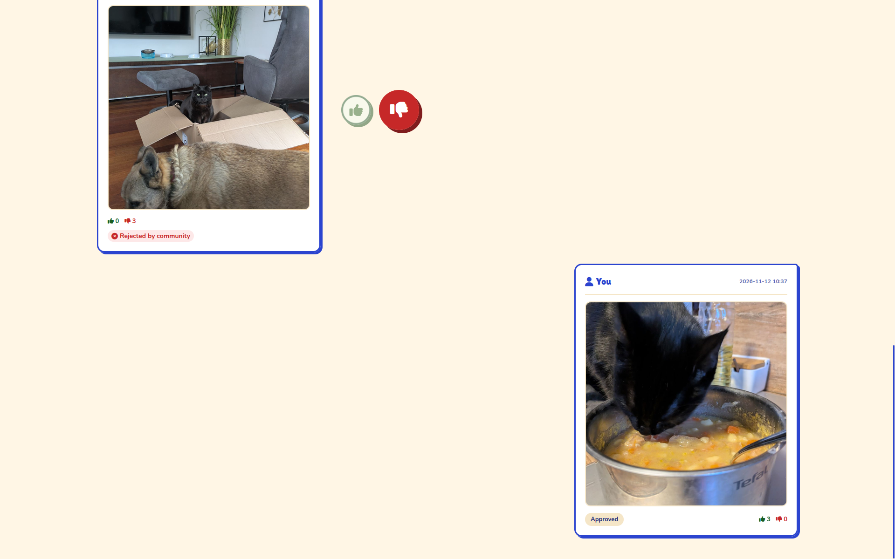

## Payment & Payout History

The payment and payout methods use PayPal webhooks to ensure we handle every success and every failure—no money is lost in some mysterious way.
On the challenge detail page, you can see the number of participants, the Payment History, and the Payout history (only after the challenge ends).

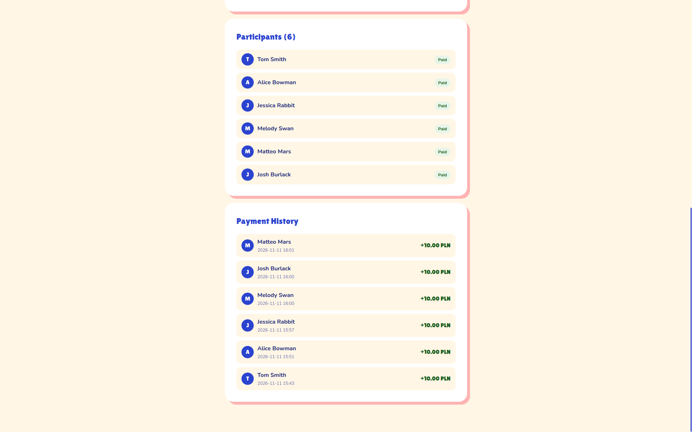

## About Us & Built With

You can find more about our team in the about section. 
You can also find there some info about the technology behind this project, but if you wish to learn more—you are welcome to read the README, maybe even test it for yourself!

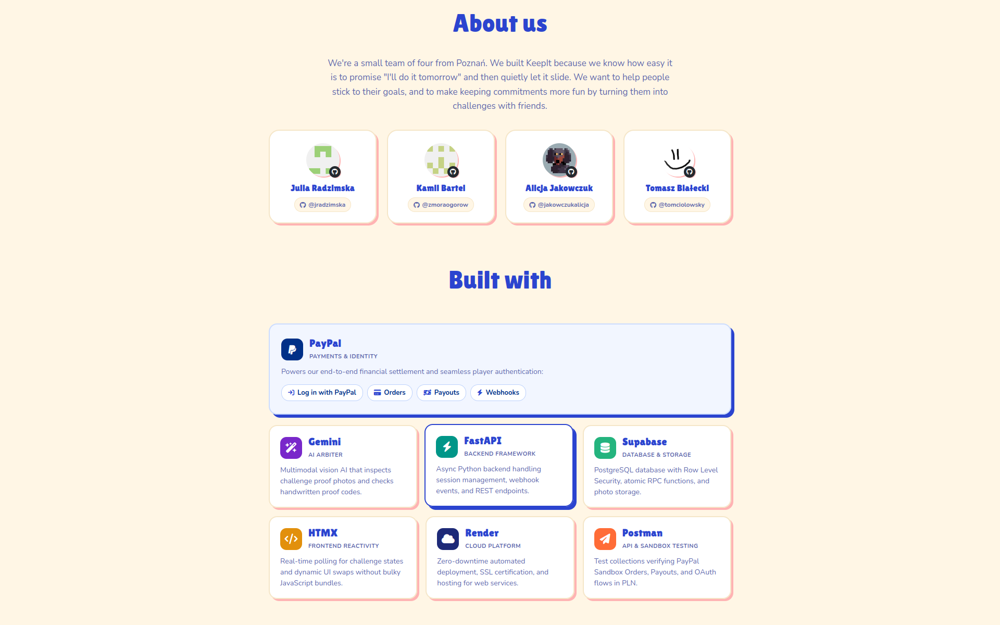